## 你好，我是 advance 👋

写前端，也折腾开发工具。平时用 **TypeScript / Vue / React / Node.js**。

- 🛠 最近在做 [WebIDE](https://github.com/advance-hub/webide)，把开发环境搬进浏览器。
- ☕ 日常爱好：逛 GitHub、试新工具、折腾界面。
- 💬 项目的问题和想法，欢迎在对应仓库开 Issue。

### GitHub 统计

  <a href="https://github.com/advance-hub?tab=overview"><picture><source media="(prefers-color-scheme: dark)" srcset="./assets/stats/overview-dark.svg" /></picture></a>
  <a href="https://github.com/advance-hub?tab=repositories"><picture><source media="(prefers-color-scheme: dark)" srcset="./assets/stats/languages-dark.svg" /></picture></a>

公开数据每日更新 · 等级由 <a href="https://github.com/stats-organization/github-stats-extended">GitHub Stats Extended</a> 计算，非 GitHub 官方评级。

精选项目见下方置顶仓库：WebIDE · Ant Design X · Midscene · vue3-number-scroll。
