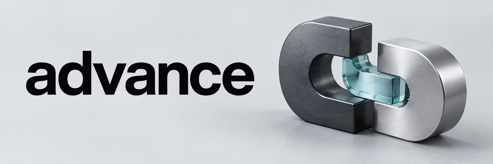
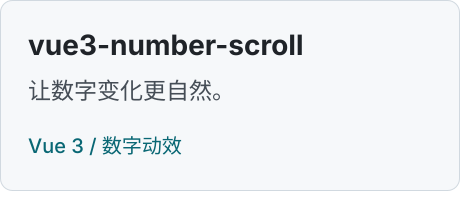
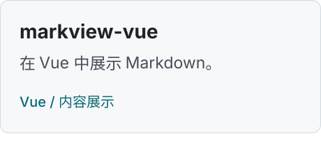
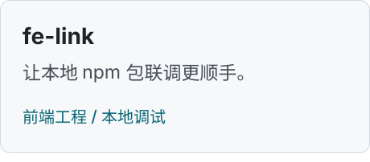
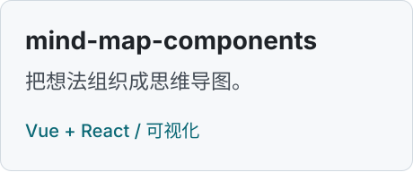

  <picture>
    <source media="(prefers-color-scheme: dark)" srcset="./assets/cover-dark.png" />
    <source media="(prefers-color-scheme: light)" srcset="./assets/cover.png" />
    
  </picture>

## 把开发中的小麻烦，做成顺手的工具。

你好，我是 **advance**。这里记录我做的开源组件与开发工具，从 Vue / React 组件，到包调试、前端监控与云端 IDE。

主要使用 **TypeScript、Vue、React 与 Node.js**，关注交互细节、工程效率和真实运行表现。

[精选作品](#精选作品) &nbsp; / &nbsp; [全部仓库](https://github.com/advance-hub?tab=repositories)

### 正在构建：WebIDE

**从一个浏览器，进入完整的开发工作区。**

基于 OpenSumi 的 Node.js 24 Web IDE，接入多人协同、个人开发机管理与 OpenSandbox。实现、性能测量和未完成的验收项一起公开记录。

[查看 WebIDE](https://github.com/advance-hub/webide) &nbsp; / &nbsp; [性能与验收记录](https://github.com/advance-hub/webide#性能量化与验收状态)

## 精选作品

  <a href="https://github.com/advance-hub/vue3-number-scroll"><picture><source media="(prefers-color-scheme: dark)" srcset="./assets/cards/vue3-number-scroll-dark.svg" /></picture></a>
  <a href="https://github.com/advance-hub/markview-vue"><picture><source media="(prefers-color-scheme: dark)" srcset="./assets/cards/markview-vue-dark.svg" /></picture></a>
  <a href="https://github.com/advance-hub/fe-link"><picture><source media="(prefers-color-scheme: dark)" srcset="./assets/cards/fe-link-dark.svg" /></picture></a>
  <a href="https://github.com/advance-hub/mind-map-components"><picture><source media="(prefers-color-scheme: dark)" srcset="./assets/cards/mind-map-components-dark.svg" /></picture></a>

  
项目文字索引

- [vue3-number-scroll](https://github.com/advance-hub/vue3-number-scroll)：Vue 3 数字滚动组件。
- [markview-vue](https://github.com/advance-hub/markview-vue)：在 Vue 中展示 Markdown。
- [fe-link](https://github.com/advance-hub/fe-link)：本地 npm 包联调工具。
- [mind-map-components](https://github.com/advance-hub/mind-map-components)：Vue / React 思维导图组件。

### 还有一些小工具

[**monitor**](https://github.com/advance-hub/monitor) / 轻量级前端监控，关注核心能力。

[**indexeddb-toolkit**](https://github.com/advance-hub/indexeddb-toolkit) / 用 TypeScript 和 Promise 简化浏览器数据库操作。

---

欢迎通过各项目的 **Issues** 交流使用问题与改进想法。
